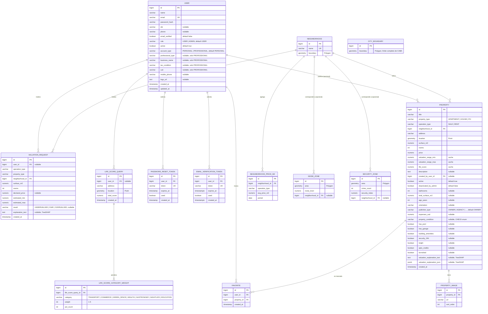

# Modelo de datos (ERD)

Diseño de entidades para el backend de Nidio. El núcleo (autenticación, valuación, visualización geoespacial, Life Score y exploración de propiedades) se derivó de las 18 historias de usuario (HU-01 a HU-18) del informe formal, agrupadas en 5 épicas. Sobre ese núcleo se fueron agregando funcionalidades no cubiertas por esas 18 HU originales a medida que avanzó el desarrollo (panel de administración, cuentas profesionales, publicación de propiedades por el usuario, favoritos) — se documentan igual, bajo la épica con la que más relación tienen.

Base de datos: PostgreSQL + PostGIS. Los tipos `geometry` usan SRID 4326 (WGS84, el estándar de lat/lon que también usa OpenStreetMap).

**Actualizado (12/08/2026) para reflejar el schema real de las migraciones V1 a V29** — la versión anterior de este documento solo cubría hasta V1/V2 (el diseño inicial) y había quedado desactualizada respecto a lo agregado desde entonces.

## Supuestos y decisiones abiertas (histórico) y su resolución real

Estos eran los puntos abiertos al diseñar el modelo inicial (V1/V2). Se dejan documentados junto con cómo se resolvieron realmente, en vez de borrarlos, porque son parte del razonamiento de diseño:

- Nombres de entidades y campos en inglés (convención habitual en backends Java), textos de negocio en español. **Se mantuvo así en todas las migraciones posteriores.**
- ~~El catálogo de propiedades (`PROPERTY`) es sintético~~ — **superado**: `PROPERTY` empezó siendo 100% sintético (V2/V10), pero desde V25/V26 el catálogo sintético se reemplazó por 200 propiedades reales tasadas con el modelo XGBoost real, y `property.created_by_user_id` (V13) permite además que un usuario publique una propiedad propia (`PROPERTY_IMAGE`, `PROPERTY.publisher_type`, etc., agregados en V15/V16 para soportar ese flujo de "Publicar").
- `VALUATION_REQUEST` y `LIFE_SCORE_QUERY` guardan un historial de cada consulta, con `user_id` nullable para no obligar login en la simulación de estas herramientas. **Se mantuvo así.**
- `NOISE_ZONE`, `SECURITY_ZONE` y `NEIGHBORHOOD_PRICE_M2` son capas precalculadas a partir de IDECBA/BA Data, sin FK directa al diseñarse. **Parcialmente superado**: desde V9, `NOISE_ZONE` y `SECURITY_ZONE` sí tienen `neighborhood_id` (FK nullable, resuelta por intersección espacial del centroide) para poder mostrar el nombre del barrio al hacer click en el mapa — se siguen consultando también por intersección/cercanía espacial contra la ubicación de una propiedad o dirección.
- Los POIs de OpenStreetMap (para Life Score) se consultan en vivo vía OSMnx desde el ml-service y no se persisten en esta base. **Se mantuvo así** (sin tabla de caché de POIs).
- No hay tabla para las 7 categorías de POI: se modela como enum de Java, no como tabla. **Se mantuvo así.**
- **Nuevo (no estaba en el diseño original)**: el contorno completo de CABA para el mapa (`CITY_BOUNDARY`, V28/V29) se pensó primero como una unión geométrica en vivo de los ~48 polígonos de `NEIGHBORHOOD` (sin tabla propia), pero se descartó: al venir de una digitalización barrio por barrio, los bordes compartidos entre barrios vecinos no coinciden coordenada por coordenada, y la unión en vivo (incluso con buffer/dissolve) dejaba costuras visibles dentro del área. Se resolvió con una tabla propia, cargada una única vez desde el dataset oficial "Perímetro" de Buenos Aires Data (un polígono de límite de ciudad, no derivado de unir barrios).

## Diagrama



## Entidades por épica

### Épica 1 — Autenticación

- **USER** — cuenta de usuario (HU-01, HU-02). `password_hash` se guarda con BCrypt, nunca en texto plano, según el NFR de seguridad del informe. Se extendió más allá de las 18 HU originales con: verificación de email obligatoria (`email_verified`, ligada a `EMAIL_VERIFICATION_TOKEN`), rol y baja lógica para el panel de administración (`role`, `active`), y datos de cuenta profesional para inmobiliarias/corredores/desarrolladores (`account_type`, `professional_type`, `business_name`, `tax_condition`, `cuit`, `mobile_phone`, `logo_url`).
- **PASSWORD_RESET_TOKEN** — token de un solo uso con expiración, para el flujo de "olvidé mi contraseña" (HU-03).
- **EMAIL_VERIFICATION_TOKEN** — mismo patrón que `PASSWORD_RESET_TOKEN`, para confirmar el mail al registrarse (no estaba en las 18 HU originales; se agregó como requisito posterior). HU-04 (logout) sigue sin tabla propia: invalidación del JWT del lado del cliente.

### Épica 2 — Valuación de Propiedades

- **VALUATION_REQUEST** — cada consulta al modelo de valuación (HU-05, HU-06, HU-07): guarda los inputs (tipo de operación, tipo de propiedad, barrio, superficie, ambientes), el rango devuelto por el ml-service, la comparación contra un precio declarado por el usuario (sobre/sub/dentro de rango), y desde que el modelo XGBoost quedó entrenado, el texto de explicación generado vía TreeSHAP (`explanation_text`).
- Depende de **NEIGHBORHOOD** para asociar la consulta a un barrio.

### Épica 3 — Visualización Geoespacial

- **NEIGHBORHOOD** — los barrios de CABA con su polígono, usado tanto para filtrar propiedades como para agregación de precios.
- **CITY_BOUNDARY** — el contorno completo de CABA (no estaba en el diseño original): una única fila con el polígono oficial de límite de ciudad, para dibujar el borde del mapa en "Explorar propiedades". Deliberadamente NO es una unión de `NEIGHBORHOOD` (ver "Supuestos" arriba) — se carga desde una fuente oficial propia.
- **NEIGHBORHOOD_PRICE_M2** — precio promedio por m² agregado por barrio y tipo de operación (dataset IDECBA), es la fuente del heatmap de precios (HU-08, HU-09) y de la consulta puntual por barrio (HU-10).
- **NOISE_ZONE** — niveles de ruido por zona (BA Data), fuente del heatmap de ruido (HU-11). Desde V9 tiene `neighborhood_id` (FK nullable, resuelta por intersección espacial) para poder mostrar el nombre del barrio al hacer click.
- **SECURITY_ZONE** — índice de seguridad por zona basado en delitos (BA Data), fuente del heatmap de seguridad (HU-12), mismo agregado de `neighborhood_id` que `NOISE_ZONE`. Estas dos también alimentan el Life Score como variables de penalización/bonificación.

### Épica 4 — Life Score

- **LIFE_SCORE_QUERY** — una consulta de Life Score sobre una dirección (HU-13), con el score total resultante.
- **LIFE_SCORE_CATEGORY_WEIGHT** — el peso que el usuario asignó a cada una de las 7 categorías de POI (HU-14), y cuántos POIs se encontraron en esa categoría (soporta HU-15, ver los POIs en el mapa).

### Épica 5 — Exploración de Propiedades

- **PROPERTY** — el catálogo de propiedades (HU-16, HU-17): hoy son 200 propiedades reales tasadas con el modelo XGBoost (no ya el catálogo sintético original, ver "Supuestos" arriba), más las que publican los propios usuarios. Cachea el rango de valuación y el Life Score para que listar y filtrar el catálogo no dispare una consulta al ml-service por cada propiedad. Se extendió bastante más allá del diseño inicial: `description`/`created_by_user_id`/`publisher_type` para el flujo de "Publicar", `active`/`deactivated_by_admin` para altas/bajas (usuario y panel admin respectivamente), `bathrooms`/`total_surface_m2`/`age_years`/`orientation`/`expenses_usd`/`property_condition`/amenities booleanos (`has_pool`, `has_garage`, `building_amenities`, `security_24h`, `bright`, `apto_credito`, `furnished`) como las variables reales que usa el modelo de valuación y se muestran en la ficha de detalle, y `valuation_explanation_text`/`valuation_explanation_json` (texto/JSON de TreeSHAP).
- **PROPERTY_IMAGE** — reemplaza a la columna original `property.image_url` (una sola foto): una propiedad puede tener varias fotos ordenadas (`sort_order`). `ON DELETE CASCADE` para no dejar fotos huérfanas.
- **FAVORITE** — no estaba en las 18 HU originales; reemplaza al historial de "Mis búsquedas" como forma principal de guardar propiedades de interés. `UNIQUE (user_id, property_id)` evita duplicados, `ON DELETE CASCADE` en ambas FK.
- La búsqueda "propiedades a menos de 2km de una dirección" (HU-18) se resuelve con una consulta espacial `ST_DWithin` sobre `PROPERTY.location`, sin entidad adicional.

## Índices

Necesarios desde la primera migración, no como optimización posterior — sin ellos, los heatmaps y la búsqueda por radio no van a cumplir los NFR de performance (mapas < 3s, valuación/Life Score < 5s):

| Tabla | Índice | Por qué |
|-------|--------|---------|
| `USER` | único en `email` | login y validación de registro duplicado (HU-01, HU-02) |
| `PASSWORD_RESET_TOKEN` | único en `token` | lookup directo al confirmar el reset (HU-03) |
| `EMAIL_VERIFICATION_TOKEN` | único en `token` | lookup directo al confirmar el mail |
| `NEIGHBORHOOD` | GiST en `boundary` | joins espaciales para asignar barrio a una propiedad o punto |
| `CITY_BOUNDARY` | GiST en `boundary` | consistencia con el resto de las tablas geoespaciales (una sola fila, no crítico para performance) |
| `PROPERTY` | GiST en `location` | `ST_DWithin` del radio de 2km (HU-18) |
| `PROPERTY` | B-tree en `neighborhood_id`, `property_type`, `operation_type` | filtros del catálogo (HU-16) |
| `PROPERTY_IMAGE` | B-tree en `property_id` | traer las fotos de una propiedad en la ficha de detalle |
| `FAVORITE` | único en (`user_id`, `property_id`) | evitar duplicados al marcar/desmarcar |
| `NOISE_ZONE` | GiST en `area` | heatmap de ruido (HU-11) |
| `SECURITY_ZONE` | GiST en `area` | heatmap de seguridad (HU-12) |
| `NEIGHBORHOOD_PRICE_M2` | B-tree en (`neighborhood_id`, `operation_type`, `period`) | armar el heatmap de precios agrupado (HU-08, HU-09) |
| `VALUATION_REQUEST` | B-tree en `user_id` | historial de valuaciones de un usuario |
| `LIFE_SCORE_QUERY` | GiST en `location` | eventual reuso/caché de consultas por proximidad |

En PostGIS, los índices espaciales se crean con `USING GIST`, por ejemplo:

```sql
CREATE INDEX idx_property_location ON property USING GIST (location);
```

## Historial de migraciones (V1 → V29)

Referencia rápida de qué migración tocó qué, para no tener que abrir cada archivo de `backend/src/main/resources/db/migration/` para saber dónde se originó una columna:

| Migración | Qué agrega/cambia |
|-----------|--------------------|
| V1 | Schema inicial: `user`, `password_reset_token`, `neighborhood`, `neighborhood_price_m2`, `noise_zone`, `security_zone`, `property`, `valuation_request`, `life_score_query`, `life_score_category_weight` |
| V2 | Seed sintético inicial (barrios como rectángulos `ST_MakeEnvelope`, catálogo de propiedades placeholder) |
| V3 | `user`: agrega `last_name`, `dni`, `phone` |
| V4 | `user`: elimina `last_name` (quedó sin uso) |
| V5, V6 | Reemplaza los rectángulos de `neighborhood.boundary` por geometría real (Buenos Aires Data, dataset "Barrios") |
| V7 | Geometría real para `noise_zone`/`security_zone` (una zona por barrio, en vez de los rectángulos tipo "corredor de avenida" de V2) |
| V8 | Precios reales de IDECBA en `neighborhood_price_m2` |
| V9 | `noise_zone`/`security_zone`: agrega `neighborhood_id` (FK, resuelta por intersección espacial) |
| V10 | Catálogo sintético ampliado por segmentos de precio |
| V11 | `user`: agrega `email_verified`; nueva tabla `email_verification_token` |
| V12 | `user`: agrega `role`, `active` (panel admin) |
| V13 | `property`: agrega `description`, `created_by_user_id` (flujo "Publicar") |
| V14 | `property`: agrega `active` (baja lógica) |
| V15 | Nueva tabla `property_image`; elimina `property.image_url` (migra el dato existente antes de borrar) |
| V16 | `property`: agrega `bathrooms`, `total_surface_m2`, `age_years`, `orientation`, `publisher_type` |
| V17 | Seed de inmobiliarias/publicadores demo y avisos |
| V18 | Dato puntual: teléfono de la inmobiliaria demo (sin cambio de schema) |
| V19 | `user`: agrega `account_type`, `professional_type`, `business_name`, `tax_condition`, `cuit`, `mobile_phone` (cuentas profesionales) |
| V20 | Nueva tabla `favorite` |
| V21 | `user`: agrega `logo_url` |
| V22 | Seed: logo de la inmobiliaria demo (sin cambio de schema) |
| V23 | `property`: agrega `deactivated_by_admin` |
| V24 | `property`: agrega `expenses_usd`, `property_condition`, `has_pool`, `has_garage`, `building_amenities`, `security_24h`, `bright`, `apto_credito`, `furnished`, `valuation_explanation_text`, `valuation_explanation_json`; `valuation_request`: agrega `explanation_text` |
| V25, V26 | Reemplaza el catálogo sintético por 200 propiedades reales tasadas con el modelo XGBoost |
| V27 | Seed: usuario admin de prueba |
| V28 | Nueva tabla `city_boundary` (sin datos) |
| V29 | Seed: polígono real del perímetro de CABA en `city_boundary` (dataset "Perímetro" de Buenos Aires Data) |

## Próximo paso sugerido

El modelo de datos está en producción (Render) siguiendo este ERD. Si en el informe formal hay una sección de "diccionario de datos" (tabla, columna, tipo, descripción) separada del ERD, conviene revisarla contra este documento — quedó desactualizada en el mismo punto en el que estaba este ERD antes de esta revisión (cubría probablemente solo hasta el diseño inicial V1/V2, no las tablas y columnas agregadas en V9 a V29).
