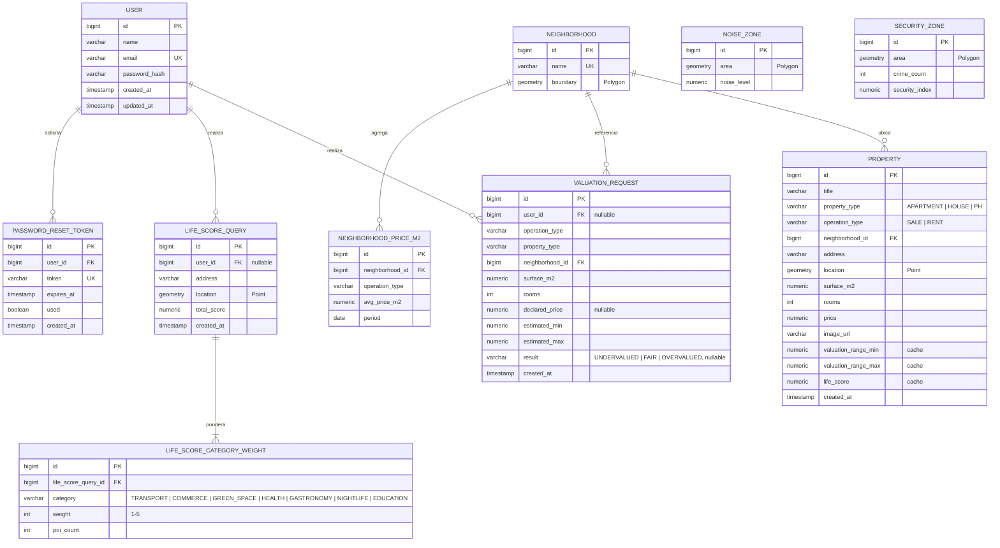

# Modelo de datos (ERD)

Diseño de entidades para el backend de Nidio, derivado de las 18 historias de usuario (HU-01 a HU-18) del informe formal, agrupadas en las 5 épicas: Autenticación, Valuación, Visualización Geoespacial, Life Score y Exploración de Propiedades.

Base de datos: PostgreSQL + PostGIS. Los tipos `geometry` usan SRID 4326 (WGS84, el estándar de lat/lon que también usa OpenStreetMap).

## Supuestos y decisiones abiertas

Estos puntos no están definidos en la documentación formal y quedan como supuestos de diseño a revisar con tu compañera antes de generar la migración Flyway:

- Nombres de entidades y campos en inglés (convención habitual en backends Java), textos de negocio en español.
- El catálogo de propiedades (`PROPERTY`) es sintético: se genera con el generador de datos placeholder mientras no estén cargados los datasets reales, pero la estructura de la tabla es la misma.
- `VALUATION_REQUEST` y `LIFE_SCORE_QUERY` guardan un historial de cada consulta (útil para analytics y para HU-17, que pide ver valuación y Life Score en el detalle de una propiedad). Permiten `user_id` nulo para no obligar login en la simulación de estas herramientas, a definir según si Épica 1 bloquea todo o solo algunas funcionalidades.
- `NOISE_ZONE`, `SECURITY_ZONE` y `NEIGHBORHOOD_PRICE_M2` son capas precalculadas a partir de IDECBA/BA Data (no las genera el usuario), se consultan por intersección/cercanía espacial contra la ubicación de una propiedad o dirección, no tienen FK directa.
- Los POIs de OpenStreetMap (para Life Score) se consultan en vivo vía OSMnx desde el ml-service y no se persisten en esta base — si el cálculo de <5s lo requiere, se puede agregar una tabla de caché de POIs más adelante.
- No hay tabla para las 7 categorías de POI (`TRANSPORT`, `COMMERCE`, `GREEN_SPACE`, `HEALTH`, `GASTRONOMY`, `NIGHTLIFE`, `EDUCATION`): al ser una lista fija de 7 valores, se modela como enum de Java, no como tabla.

## Diagrama



## Entidades por épica

### Épica 1 — Autenticación

- **USER** — cuenta de usuario (HU-01, HU-02). `password_hash` se guarda con BCrypt, nunca en texto plano, según el NFR de seguridad del informe.
- **PASSWORD_RESET_TOKEN** — token de un solo uso con expiración, para el flujo de "olvidé mi contraseña" (HU-03). HU-04 (logout) no necesita tabla propia: es invalidación del token JWT del lado del cliente (o, si se decide llevar una blacklist, se puede agregar `REVOKED_TOKEN` más adelante).

### Épica 2 — Valuación de Propiedades

- **VALUATION_REQUEST** — cada consulta al modelo de valuación (HU-05, HU-06, HU-07): guarda los inputs (tipo de operación, tipo de propiedad, barrio, superficie, ambientes), el rango devuelto por el ml-service, y si corresponde, la comparación contra un precio declarado por el usuario (sobre/sub/dentro de rango).
- Depende de **NEIGHBORHOOD** para asociar la consulta a un barrio.

### Épica 3 — Visualización Geoespacial

- **NEIGHBORHOOD** — los barrios de CABA con su polígono, usado tanto para filtrar propiedades como para agregación de precios.
- **NEIGHBORHOOD_PRICE_M2** — precio promedio por m² agregado por barrio y tipo de operación (dataset IDECBA), es la fuente del heatmap de precios (HU-08, HU-09) y de la consulta puntual por barrio (HU-10).
- **NOISE_ZONE** — niveles de ruido por zona (BA Data), fuente del heatmap de ruido (HU-11).
- **SECURITY_ZONE** — índice de seguridad por zona basado en delitos (BA Data), fuente del heatmap de seguridad (HU-12). Estas dos también alimentan el Life Score como variables de penalización/bonificación.

### Épica 4 — Life Score

- **LIFE_SCORE_QUERY** — una consulta de Life Score sobre una dirección (HU-13), con el score total resultante.
- **LIFE_SCORE_CATEGORY_WEIGHT** — el peso que el usuario asignó a cada una de las 7 categorías de POI (HU-14), y cuántos POIs se encontraron en esa categoría (soporta HU-15, ver los POIs en el mapa).

### Épica 5 — Exploración de Propiedades

- **PROPERTY** — el catálogo sintético de propiedades (HU-16, HU-17). Cachea el rango de valuación y el Life Score para que listar y filtrar el catálogo no dispare una consulta al ml-service por cada propiedad.
- La búsqueda "propiedades a menos de 2km de una dirección" (HU-18) se resuelve con una consulta espacial `ST_DWithin` sobre `PROPERTY.location`, sin entidad adicional.

## Índices

Necesarios desde la primera migración, no como optimización posterior — sin ellos, los heatmaps y la búsqueda por radio no van a cumplir los NFR de performance (mapas < 3s, valuación/Life Score < 5s):

| Tabla | Índice | Por qué |
|-------|--------|---------|
| `USER` | único en `email` | login y validación de registro duplicado (HU-01, HU-02) |
| `PASSWORD_RESET_TOKEN` | único en `token` | lookup directo al confirmar el reset (HU-03) |
| `NEIGHBORHOOD` | GiST en `boundary` | joins espaciales para asignar barrio a una propiedad o punto |
| `PROPERTY` | GiST en `location` | `ST_DWithin` del radio de 2km (HU-18) |
| `PROPERTY` | B-tree en `neighborhood_id`, `property_type`, `operation_type` | filtros del catálogo (HU-16) |
| `NOISE_ZONE` | GiST en `area` | heatmap de ruido (HU-11) |
| `SECURITY_ZONE` | GiST en `area` | heatmap de seguridad (HU-12) |
| `NEIGHBORHOOD_PRICE_M2` | B-tree en (`neighborhood_id`, `operation_type`, `period`) | armar el heatmap de precios agrupado (HU-08, HU-09) |
| `VALUATION_REQUEST` | B-tree en `user_id` | historial de valuaciones de un usuario |
| `LIFE_SCORE_QUERY` | GiST en `location` | eventual reuso/caché de consultas por proximidad |

En PostGIS, los índices espaciales se crean con `USING GIST`, por ejemplo:

```sql
CREATE INDEX idx_property_location ON property USING GIST (location);
```

## Próximo paso sugerido

Con este ERD validado, el siguiente paso natural es traducirlo a la primera migración Flyway (`V1__init.sql`) y a las clases `@Entity` correspondientes en `backend/src/main/java/com/nidio/model/` — recomendado empezar por `USER` y `PASSWORD_RESET_TOKEN` para poder programar la Épica 1 (Auth) end-to-end, como está priorizado en el estado del proyecto.
