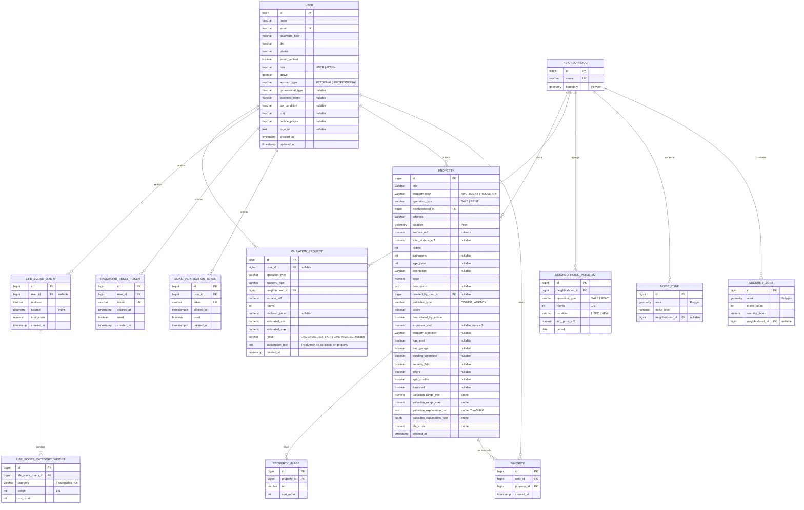

# Modelo de datos (ERD)

Diseño de entidades para el backend de Nidio, derivado de las 18 historias de usuario (HU-01 a HU-18) del informe formal, agrupadas en las 5 épicas: Autenticación, Valuación, Visualización Geoespacial, Life Score y Exploración de Propiedades.

Base de datos: PostgreSQL + PostGIS. Los tipos `geometry` usan SRID 4326 (WGS84, el estándar de lat/lon que también usa OpenStreetMap).

> **Actualizado (11/08/2026)** a partir del esquema realmente aplicado (`backend/src/main/resources/db/migration`, V1 a V26), no del diseño original previo al desarrollo. El esquema creció de 10 a 13 tablas a lo largo de 25 migraciones incrementales posteriores a `V1__init.sql`. Ver "Historial de cambios respecto del diseño original" al final de este documento.

## Supuestos y decisiones abiertas (vigentes desde el diseño original)

- Nombres de entidades y campos en inglés (convención habitual en backends Java), textos de negocio en español.
- `NOISE_ZONE`, `SECURITY_ZONE` y `NEIGHBORHOOD_PRICE_M2` son capas precalculadas a partir de IDECBA/BA Data (no las genera el usuario), se consultan por intersección/cercanía espacial contra la ubicación de una propiedad o dirección. Desde V9 sí tienen FK directa a `NEIGHBORHOOD` (ver más abajo), resuelta por contención espacial (`ST_Contains` del centroide), no por nombre.
- Los POIs de OpenStreetMap (para Life Score) se consultan en vivo vía OSMnx desde el ml-service y no se persisten en esta base.
- No hay tabla para las 7 categorías de POI (`TRANSPORT`, `COMMERCE`, `GREEN_SPACE`, `HEALTH`, `GASTRONOMY`, `NIGHTLIFE`, `EDUCATION`): al ser una lista fija de 7 valores, se modela como enum de Java, no como tabla.

## Diagrama



## Entidades por épica

### Épica 1 — Autenticación

- **USER** — cuenta de usuario (HU-01, HU-02). `password_hash` se guarda con BCrypt, nunca en texto plano. Extendida respecto del diseño original con: `email_verified` (V11, verificación de email obligatoria antes de poder loguear), `role`/`active` (V12, rol ADMIN y baja lógica para el panel admin), y los campos de cuenta profesional `account_type`/`professional_type`/`business_name`/`tax_condition`/`cuit`/`mobile_phone`/`logo_url` (V19/V21, para que inmobiliarias y corredores tengan datos fiscales propios, no solo nombre/email/teléfono de una cuenta particular).
- **PASSWORD_RESET_TOKEN** — token de un solo uso con expiración, para "olvidé mi contraseña" (HU-03).
- **EMAIL_VERIFICATION_TOKEN** *(nueva, V11)* — mismo patrón que `PASSWORD_RESET_TOKEN`, para el flujo de verificación de email al registrarse.

### Épica 2 — Valuación de Propiedades

- **VALUATION_REQUEST** — cada consulta al modelo de valuación real (HU-05, HU-06, HU-07): inputs (tipo de operación, tipo de propiedad, barrio, superficie, ambientes), el rango devuelto por el ml-service (Run C, XGBoost), y si corresponde, la comparación contra un precio declarado por el usuario. Extendida con `explanation_text` (V24): el texto en español generado por TreeSHAP explicando qué factores influyeron en la predicción. Las características opcionales del formulario (baños, expensas, amenities) no se persisten acá — son input efímero que solo se usa para armar el pedido al ml-service.
- Depende de **NEIGHBORHOOD** para asociar la consulta a un barrio.

### Épica 3 — Visualización Geoespacial

- **NEIGHBORHOOD** — los barrios de CABA con su polígono real.
- **NEIGHBORHOOD_PRICE_M2** — precio promedio por m² agregado por barrio, tipo de operación, ambientes (1-3) y condición (usado/a estrenar) — dato real de IDECBA (V8), fuente del heatmap de precios (HU-08, HU-09) y también ground truth de calibración del modelo de valuación.
- **NOISE_ZONE** — niveles de ruido por zona (BA Data), fuente del heatmap de ruido (HU-11). Vinculada a `NEIGHBORHOOD` desde V9 por contención espacial.
- **SECURITY_ZONE** — índice de seguridad por zona basado en delitos (BA Data), fuente del heatmap de seguridad (HU-12). Vinculada a `NEIGHBORHOOD` desde V9. Estas dos también alimentan Life Score como variables de penalización/bonificación.

### Épica 4 — Life Score

- **LIFE_SCORE_QUERY** — una consulta de Life Score sobre una dirección (HU-13), con el score total resultante.
- **LIFE_SCORE_CATEGORY_WEIGHT** — el peso que el usuario asignó a cada una de las 7 categorías de POI (HU-14), y cuántos POIs se encontraron en esa categoría (HU-15).

### Épica 5 — Exploración y Publicación de Propiedades

- **PROPERTY** — el catálogo de propiedades (HU-16, HU-17). Ya no es solo sintético: desde V25/V26 son 200 propiedades reales (dataset de entrenamiento del modelo), reemplazando al catálogo sintético original. Cachea el rango de valuación, el texto/JSON de explicación TreeSHAP y el Life Score para no disparar una consulta al ml-service por cada propiedad al listar el catálogo. Extendida significativamente respecto del diseño original: `description`/`created_by_user_id` (V13, flujo de "Publicar"), `active` (V14, baja lógica), `bathrooms`/`total_surface_m2`/`age_years`/`orientation`/`publisher_type` (V16), `deactivated_by_admin` (V23, distinta de `active` — baja forzada desde el panel admin), y los 9 campos que necesita el modelo XGBoost real: `expenses_usd`, `property_condition`, `has_pool`, `has_garage`, `building_amenities`, `security_24h`, `bright`, `apto_credito`, `furnished` (V24).
- **PROPERTY_IMAGE** *(nueva, V15)* — una propiedad puede tener varias fotos, no solo una. Reemplaza a la columna `property.image_url` original (migrada y luego eliminada).
- **FAVORITE** *(nueva, V20)* — reemplaza a "Mis búsquedas" (que mostraba historial de valuaciones/Life Score) por propiedades que el usuario marcó explícitamente. `UNIQUE(user_id, property_id)` evita duplicados.
- La búsqueda "propiedades a menos de 2km de una dirección" (HU-18) se resuelve con `ST_DWithin` sobre `PROPERTY.location`, sin entidad adicional.

## Índices

| Tabla | Índice | Por qué |
|-------|--------|---------|
| `USER` | único en `email` | login y validación de registro duplicado (HU-01, HU-02) |
| `PASSWORD_RESET_TOKEN` | único en `token` | lookup directo al confirmar el reset (HU-03) |
| `NEIGHBORHOOD` | GiST en `boundary` | joins espaciales para asignar barrio a una propiedad o punto |
| `PROPERTY` | GiST en `location` | `ST_DWithin` del radio de 2km (HU-18) |
| `PROPERTY` | B-tree en `neighborhood_id`, `property_type`, `operation_type` | filtros del catálogo (HU-16) |
| `NOISE_ZONE` | GiST en `area` | heatmap de ruido (HU-11) |
| `SECURITY_ZONE` | GiST en `area` | heatmap de seguridad (HU-12) |
| `NEIGHBORHOOD_PRICE_M2` | B-tree en (`neighborhood_id`, `operation_type`, `period`) | armar el heatmap de precios agrupado (HU-08, HU-09) |
| `VALUATION_REQUEST` | B-tree en `user_id` | historial de valuaciones de un usuario |
| `LIFE_SCORE_QUERY` | GiST en `location` | eventual reuso/caché de consultas por proximidad |
| `PROPERTY_IMAGE` | B-tree en `property_id` | listar fotos de una propiedad en orden (V15) |

En PostGIS, los índices espaciales se crean con `USING GIST`, por ejemplo:

```sql
CREATE INDEX idx_property_location ON property USING GIST (location);
```

## Historial de cambios respecto del diseño original

Este documento se escribió antes de `V1__init.sql` y quedó como referencia de diseño, sin actualizarse durante las 25 migraciones posteriores. Resumen de lo agregado, por migración:

- **V3**: `user.dni`, `user.phone` (perfil).
- **V4**: se revierte `user.last_name` (agregada en V3, nunca se usó).
- **V8**: `neighborhood_price_m2.rooms`/`condition` — la referencia de IDECBA pasa a estar segmentada por ambientes y condición, no solo por barrio.
- **V9**: `noise_zone.neighborhood_id`, `security_zone.neighborhood_id` — vínculo espacial con `NEIGHBORHOOD`, ausente en el diseño original.
- **V11**: verificación de email — `user.email_verified` + tabla nueva `EMAIL_VERIFICATION_TOKEN`.
- **V12**: `user.role`, `user.active` — panel admin.
- **V13**: `property.description`, `property.created_by_user_id` — flujo de "Publicar".
- **V14**: `property.active` — baja lógica de propiedades.
- **V15**: tabla nueva `PROPERTY_IMAGE`, en reemplazo de `property.image_url`.
- **V16**: `property.bathrooms`/`total_surface_m2`/`age_years`/`orientation`/`publisher_type`.
- **V19**: cuentas profesionales — `user.account_type`/`professional_type`/`business_name`/`tax_condition`/`cuit`/`mobile_phone`.
- **V20**: tabla nueva `FAVORITE`, en reemplazo del historial de "Mis búsquedas".
- **V21**: `user.logo_url` — cuentas profesionales.
- **V23**: `property.deactivated_by_admin` — distinta de `active`, baja forzada desde el panel admin.
- **V24**: campos del modelo XGBoost real en `property` (`expenses_usd`, `property_condition`, `has_pool`, `has_garage`, `building_amenities`, `security_24h`, `bright`, `apto_credito`, `furnished`, `valuation_explanation_text`, `valuation_explanation_json`) y en `valuation_request` (`explanation_text`).
- **V25/V26**: el catálogo `PROPERTY` pasa de sintético a 200 propiedades reales; se elimina el catálogo sintético viejo.

## Próximo paso sugerido

Ninguno pendiente sobre el modelo de datos en sí — el esquema está estable y en producción (Vercel + Render + Postgres administrado, ver `docs/architecture/system-diagram.md`). Cambios futuros deberían seguir el mismo patrón: migración Flyway aditiva + actualización de este documento en el mismo commit, para que no vuelva a quedar desactualizado.
