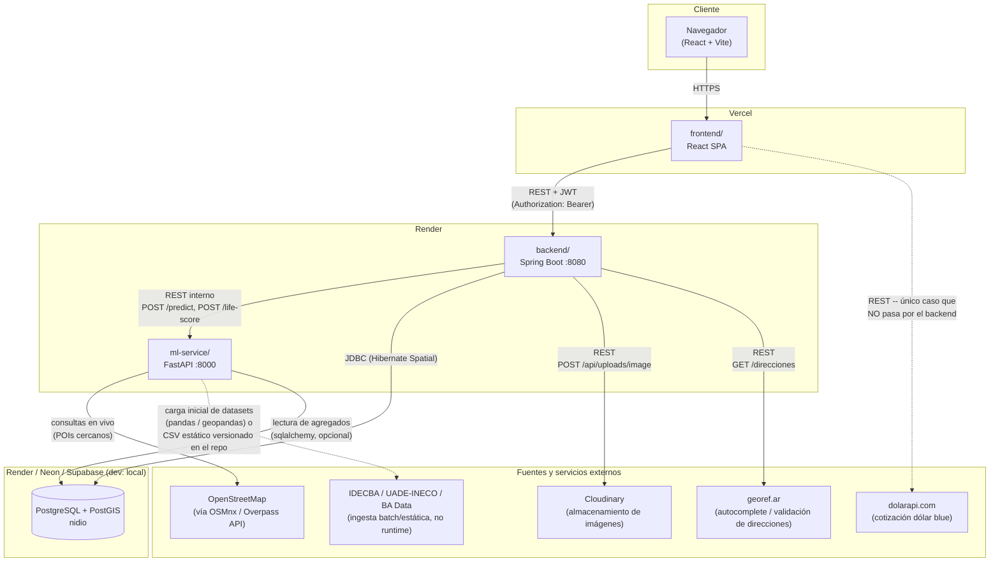

# Diagrama de arquitectura de sistema

Cómo se comunican los tres servicios del monorepo, la base de datos y las fuentes de datos externas. Complementa el [ERD](erd.md) y el [contrato de endpoints](../api/endpoints.md).

## Diagrama

## Flujos por épica

- **Auth (Épica 1):** `browser → frontend → backend`. El backend es dueño exclusivo de `USER` y `PASSWORD_RESET_TOKEN`; `ml-service` nunca ve credenciales.
- **Valuación (Épica 2):** `frontend → backend → ml-service (POST /predict) → backend` (persiste `VALUATION_REQUEST`) `→ frontend`.
- **Geoespacial (Épica 3):** `frontend → backend → db` directo. Los heatmaps se sirven desde tablas ya agregadas (`NEIGHBORHOOD_PRICE_M2`, `NOISE_ZONE`, `SECURITY_ZONE`), no hay llamada a `ml-service` en este flujo.
- **Life Score (Épica 4):** `frontend → backend → ml-service (POST /life-score) → OpenStreetMap (OSMnx, en vivo) → ml-service → backend` (persiste `LIFE_SCORE_QUERY` + pesos) `→ frontend`. Es el flujo más sensible al límite de 5 segundos (NFR), porque depende de una API externa en tiempo real.
- **Exploración (Épica 5):** `frontend → backend → db` directo, usando `ST_DWithin` sobre `PROPERTY.location` para el filtro por radio.

## Notas de despliegue

- `frontend` en Vercel, `backend` y `ml-service` como dos servicios separados en Render (según lo presupuestado: USD 20/mes c/u).
- En desarrollo local los tres servicios corren en `localhost` contra el mismo Postgres local; en producción cada uno apunta a la misma instancia gestionada (Render/Neon/Supabase) vía `DATABASE_URL`.
- `ml-service` solo necesita acceso de lectura a `db` si se decide leer agregados (`NEIGHBORHOOD_PRICE_M2`, etc.) directamente para entrenar o recalcular el modelo offline; en runtime (`/predict`, `/life-score`) no depende de la base, solo de sus artefactos de modelo (`MODEL_ARTIFACTS_PATH`), de OSM y (para Transporte) del CSV local de paradas de colectivo.
- El `frontend` no habla directo con `ml-service` ni con la base, y todas sus llamadas a la API propia pasan por `backend` (único punto de autenticación JWT y de acceso a datos) — **con una única excepción**: la cotización del dólar blue (`useBlueRate`, `lib/blueRate.js`) se consulta directo contra `dolarapi.com` desde el navegador, sin pasar por `backend`. Es la única llamada de todo el sistema a una API de terceros que no está mediada por el backend.
- `backend` además actúa como intermediario hacia dos APIs públicas más, ninguna de las cuales tiene relación con el modelo de ML: `Cloudinary` (subida de imágenes al publicar una propiedad, `POST /api/uploads/image`) y `georef.ar` (autocomplete/validación de direcciones, `GET /direcciones`, mismo patrón que usa `AddressController`).
